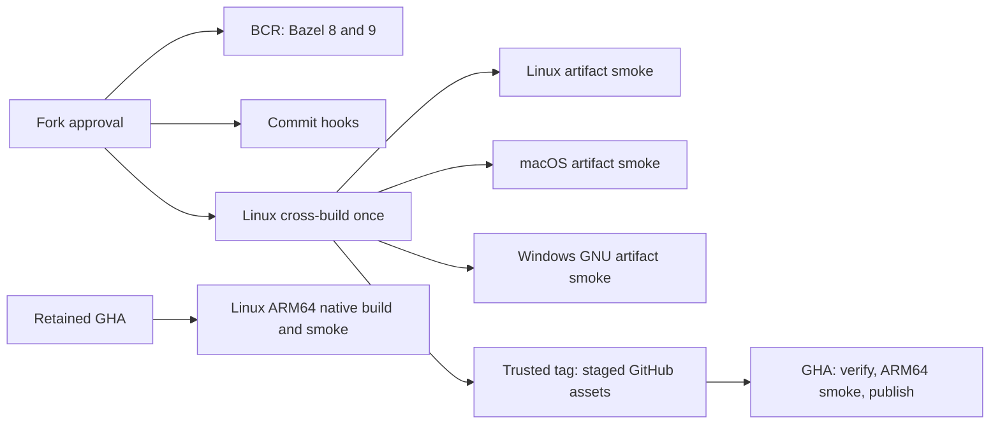

# Buildkite migration

The bootstrap approves fork commits before checkout; Renovate's verified bot identity is exempt.
All jobs pin the same PR merge commit. Bazel caches use `oss-ci-v2`, isolated by pipeline and branch; only repository/disk caches are restored.

BCR consumption runs on Bazel 8.4.1 and 9.2.0 with the same commands as GHA. One Linux producer builds optimized distributions. Native smoke jobs verify producer build, commit, pipeline, exact filenames and SHA-256 before running artifacts.

Linux ARM64 stays on GHA. MSVC coverage also stays on GHA; Windows GNU artifact smoke uses `oss_win_amd64`.

GHA retains Linux ARM64 native builds (no Buildkite ARM64 queue). Watchman also retains its separate MSVC coverage. Release Please and BCR submission wait for the exact main Buildkite status. On trusted main-reachable release tags, Buildkite stages verified artifacts with a short-lived workflow-authorized GitHub token. GHA downloads them, checks commit/pipeline/files/hashes, runs the cross-built ARM64 artifact and publishes final assets without rebuilding. No long-lived key is added to Buildkite.

Onboarding must enable tag builds, fork branch prefixes, GitHub commit statuses and workflow-authorized tokens for `bazel-opt.yml`, using existing OSS queues. Disable skipping PR builds for existing commits so rebases and reruns still publish checks. Keep these PRs unmerged until native Buildkite CI proves parity. Manual distribution publishing now requires an existing release tag.

